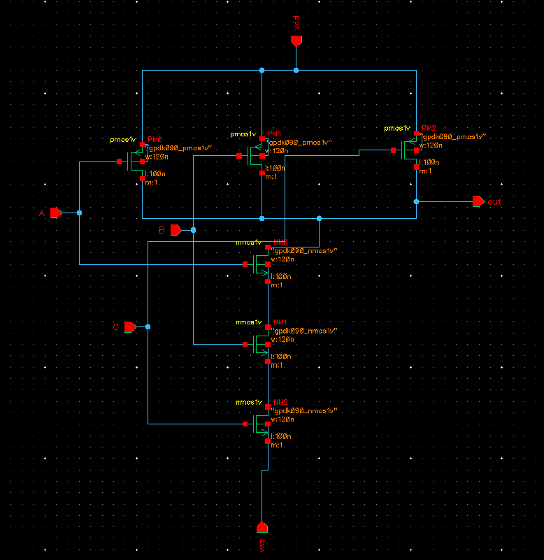
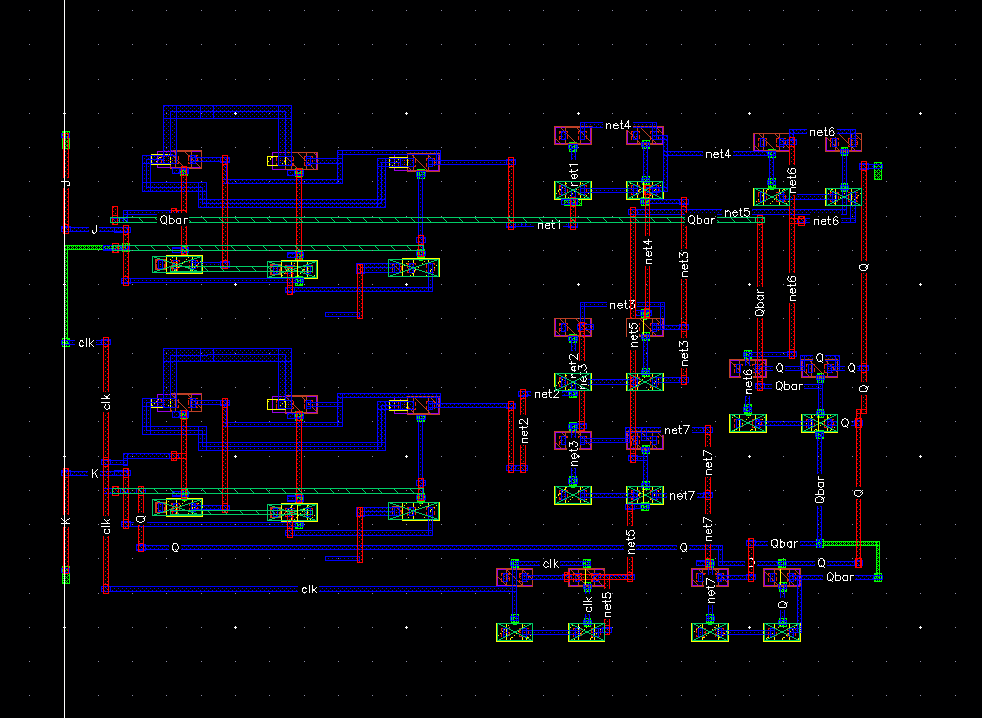

 8-Bit Asynchronous Up Counter using Master-Slave JK Flip-Flops

**Author:** Mubeena Mirshad  
**Project Guide:** Dr. P Ranga Babu  
**Design and Simulation Environment:** Cadence Virtuoso  
**Project Area:** Digital IC Design / Sequential Logic


Transistor-level schematic and physical layout of an 8-bit asynchronous (ripple) up counter, built from NAND-based master-slave JK flip-flops in Cadence Virtuoso using the `gpdk090` 90 nm process.

---

## Table of Contents

- [Overview](#overview)
- [Design Hierarchy and Architecture](#design-hierarchy-and-architecture)
- [Technology and Device Sizing](#technology-and-device-sizing)
- [Circuit Schematics and Physical Layouts](#circuit-schematics-and-physical-layouts)
  - [1. 2-Input CMOS NAND Gate](#1-2-input-cmos-nand-gate)
  - [2. 3-Input CMOS NAND Gate](#2-3-input-cmos-nand-gate)
  - [3. Master-Slave JK Flip-Flop](#3-master-slave-jk-flip-flop)
  - [4. 8-Bit Asynchronous Up Counter](#4-8-bit-asynchronous-up-counter)
- [Transient Simulation Results](#transient-simulation-results)
- [Performance Analysis](#performance-analysis)
  - [Key Specifications](#key-specifications)
  - [Timing Estimates](#timing-estimates)
  - [Power, PDP and EDP](#power-pdp-and-edp)
- [Repository Structure](#repository-structure)
- [How to Reproduce](#how-to-reproduce)
- [Conclusion](#conclusion)

---

## Overview

An 8-bit asynchronous up counter steps through the binary states `00000000` (0) to `11111111` (255) and then rolls over, so it is a MOD-256 counter.

A level-triggered JK flip-flop with J = K = 1 toggles repeatedly while the clock stays high (the race-around condition). To avoid this, each stage here is a master-slave JK flip-flop made entirely of static CMOS NAND gates.

Every flip-flop is wired in toggle mode (J = K = V<sub>DD</sub>). The master is transparent while the clock is high and the slave while it is low, so a stage changes its output on the **falling edge** of its clock input. The clock drives only the first stage (Q0). Each later stage is clocked by the **Q output** of the previous stage, so a falling edge on Q(n-1) toggles Q(n). This is what makes the counter count up. Driving each stage from Q̄ instead would make it count down.

Because the clock ripples through the chain instead of reaching all stages at once, the outputs do not change at the same instant. The resulting delay is analysed in [Performance Analysis](#performance-analysis).

---

## Design Hierarchy and Architecture

The design follows a bottom-up full-custom methodology.

1. **Leaf cells**
   - 2-input CMOS NAND gate (`pmos1v`, `nmos1v`), 4 transistors
   - 3-input CMOS NAND gate (`pmos1v`, `nmos1v`), 6 transistors

2. **Master-slave JK flip-flop** (9 gates, 40 transistors)
   - 2 × 3-input NAND: input steering, J·CLK·Q̄ and K·CLK·Q, with Q and Q̄ fed back from the slave
   - 2 × 2-input NAND: master SR latch
   - 2 × 2-input NAND: slave gating, driven by the inverted clock
   - 2 × 2-input NAND: slave SR latch, which produces Q and Q̄
   - 1 × 2-input NAND with its inputs tied together: clock inverter for the slave

3. **Top level**
   - Eight cascaded flip-flops `FF0` to `FF7` give outputs `Q0` (LSB) to `Q7` (MSB), 320 transistors in total.

---

## Technology and Device Sizing

| Parameter | Specification |
|:---|:---|
| EDA suite | Cadence Virtuoso (Schematic Editor, ADE L with Spectre, Layout Suite XL) |
| Process design kit | `gpdk090` (90 nm generic PDK) |
| Device models | `gpdk090_pmos1v` / `gpdk090_nmos1v` |
| Channel length (L) | 100 nm |
| Channel width (W) | 120 nm, multiplier m = 1 (minimum-size devices, no PMOS upsizing) |
| Supply voltage (V<sub>DD</sub>) | 1.0 V |
| Counting range | 0 to 255 (`0x00` to `0xFF`, 256 states) |

---

## Circuit Schematics and Physical Layouts

### 1. 2-Input CMOS NAND Gate

Static CMOS gate with two parallel PMOS pull-up transistors (`PM0`, `PM1`) and two series NMOS pull-down transistors (`NM0`, `NM1`).

| Schematic View | Physical Layout View |
|:---:|:---:|
|  |  |

---

### 2. 3-Input CMOS NAND Gate

Static CMOS gate with three parallel PMOS pull-up transistors (`PM0` to `PM2`) and three series NMOS pull-down transistors (`NM0` to `NM2`).

| Schematic View | Physical Layout View |
|:---:|:---:|
|  |  |

---

### 3. Master-Slave JK Flip-Flop

Gate-level schematic and full-custom layout of the master and slave stages. Q and Q̄ from the slave are fed back to the input-steering NAND gates, which prevents the race-around condition at J = K = 1.

**Gate-Level Schematic**


**Physical Layout**



---

### 4. 8-Bit Asynchronous Up Counter

Eight master-slave JK flip-flops arranged as a 2 × 4 array, with the inter-stage ripple clock routed from each Q output to the next clock input.

**Schematic**

.jpg)

**Physical Layout**


---

## Transient Simulation Results

The transient analysis was run in Cadence Spectre with a 1.0 V square-wave clock (`/clk`) of 16 ns period (62.5 MHz) and a stop time of 4.2 µs. Each output toggles at half the rate of the one before it:

| Output | Frequency |
|:---|:---|
| `/Q0` (LSB) | f<sub>clk</sub> / 2 |
| `/Q1` | f<sub>clk</sub> / 4 |
| `/Q2` | f<sub>clk</sub> / 8 |
| `/Q3` | f<sub>clk</sub> / 16 |
| `/Q4` | f<sub>clk</sub> / 32 |
| `/Q5` | f<sub>clk</sub> / 64 |
| `/Q6` | f<sub>clk</sub> / 128 |
| `/Q7` (MSB) | f<sub>clk</sub> / 256 |

With a 16 ns period, `/Q7` first rises after 128 clock periods (about 2.05 µs) and the counter rolls over after 256 periods (about 4.10 µs), so the 4.2 µs stop time captures one full 0 to 255 sweep. Each output lags the one before it by one flip-flop delay, as discussed in [Timing Estimates](#timing-estimates).

### Window 1 (1.0 µs to 2.05 µs): Lower-to-Mid Bit Transitions


### Window 2 (2.1 µs to 3.15 µs): MSB (`/Q7`) Low-to-High Transition


### Window 3 (3.1 µs to 4.15 µs): Full Rollover (`11111111` to `00000000`)


---

## Performance Analysis

The figures below are first-order hand estimates based on assumed R<sub>eff</sub>, C<sub>load</sub> and leakage values. They are not extracted from Spectre measurements. All delays are referenced to the 50% supply level (0.5 V at V<sub>DD</sub> = 1.0 V).

### Key Specifications

| Parameter | Value |
|:---|:---|
| Technology | 90 nm CMOS (`gpdk090`) |
| Supply voltage (V<sub>DD</sub>) | 1.0 V |
| Architecture | 8-bit asynchronous (ripple) up counter, MOD-256 |
| Flip-flop | NAND-based master-slave JK, falling-edge output change |
| Transistor count | 40 per flip-flop, 320 in total |
| Clock | 62.5 MHz (16 ns period), 5 ps rise time |
| Flip-flop clock-to-Q delay (t<sub>pd</sub>) | 0.42 ns |
| Worst-case ripple delay (t<sub>ripple</sub>) | 3.24 ns |
| Average power (P<sub>avg</sub>) | 0.633 µW |
| Power-delay product (PDP) | 2.05 fJ |
| Energy-delay product (EDP) | 6.64 × 10⁻²⁴ J·s |

### Timing Estimates

**Gate level.** The delay of each gate is estimated as t<sub>pd</sub> ≈ 0.69 · R<sub>eff</sub> · C<sub>load</sub>.

| Block | R<sub>eff</sub> | C<sub>load</sub> | τ = R·C | t<sub>pd</sub> ≈ 0.69τ | Critical path |
|:---|:---:|:---:|:---:|:---:|:---|
| 2-input NAND | 20 kΩ | 10 fF | 0.20 ns | 0.14 ns | Series NMOS pull-down |
| 3-input NAND | 22 kΩ | 10 fF | 0.22 ns | 0.15 ns | Three-transistor series pull-down |

**Flip-flop and counter.** The clock-to-Q path of the master-slave flip-flop passes through three NAND2 stages (clock inverter, slave gating NAND, slave latch NAND), so t<sub>pd</sub> ≈ 3 × 0.14 ns = 0.42 ns. A rising output is assumed to be about 10% slower than a falling one because of the PMOS pull-up.

| Block | t<sub>PLH</sub> | t<sub>PHL</sub> | t<sub>pd</sub> (average) | t<sub>cd</sub> (minimum) |
|:---|:---:|:---:|:---:|:---:|
| Master-slave JK flip-flop (clock to Q) | 0.44 ns | 0.40 ns | 0.42 ns | 0.40 ns |

**Ripple delay.** The worst case is the rollover from `01111111` to `10000000`. Q0 to Q6 fall one after another and Q7 rises last, so

t<sub>ripple</sub> = 7 · t<sub>PHL</sub> + t<sub>PLH</sub> = 7 × 0.40 ns + 0.44 ns = **3.24 ns**

The clock period must be longer than t<sub>ripple</sub> so that all outputs settle before the next count. At 16 ns this leaves a wide margin. The minimum delay of the counter, t<sub>cd</sub>, is that of a single flip-flop (0.40 ns), since Q0 responds to the clock directly.

While the ripple travels, the outputs briefly show intermediate codes. For example, `01111111` to `10000000` passes through `01111110`, `01111100`, and so on. Any logic that decodes the counter outputs must be glitch-safe or wait for t<sub>ripple</sub>.

### Power, PDP and EDP

**Dynamic power.** This is a first-order estimate that counts only the eight Q output nodes, each with 10 fF of load. Output Q(n) toggles at f/2<sup>n+1</sup>, so the switching activity falls by half at every stage:

P<sub>dynamic</sub> = C · V<sub>DD</sub>² · f · Σ<sub>n=0</sub><sup>7</sup> 2<sup>-(n+1)</sup>

= (10 × 10⁻¹⁵ F)(1.0 V)²(62.5 × 10⁶ Hz)(1 − 2⁻⁸)

= 0.6226 µW

Internal flip-flop nodes also switch, so the power measured in Spectre will be higher.

**Static power.** With an assumed total leakage current of 10 nA:

P<sub>static</sub> = I<sub>leakage</sub> × V<sub>DD</sub> = (10 × 10⁻⁹ A)(1.0 V) = 0.01 µW

**Average power.**

P<sub>avg</sub> = P<sub>dynamic</sub> + P<sub>static</sub> = 0.6226 µW + 0.01 µW ≈ **0.633 µW**

Dynamic power is about 98.4% of the total and static power about 1.6%.

**Power-delay product.** This is the energy consumed over the worst-case ripple interval:

PDP = P<sub>avg</sub> × t<sub>ripple</sub> = (0.633 × 10⁻⁶ W)(3.24 × 10⁻⁹ s) = **2.05 × 10⁻¹⁵ J = 2.05 fJ**

**Energy-delay product.**

EDP = PDP × t<sub>ripple</sub> = (2.05 × 10⁻¹⁵ J)(3.24 × 10⁻⁹ s) = **6.64 × 10⁻²⁴ J·s** (equivalently 6.64 fJ·ns)

---

## Repository Structure

```text
8-bit-asynchronous-up-counter/
│
├── README.md
│
└── Images/
    ├── 01_2input_nand_schematic.png
    ├── 01_8_bit_counter_schematic (1).jpg
    ├── 02_2input_nand_layout.png
    ├── 03_3input_nand_schematic.png
    ├── 04_3input_nand_layout.png
    ├── 05_master_slave_jk_schematic.jpg
    ├── 06_master_slave_jk_layout.png
    ├── 07_8bit_asynchronous_counter_layout.png
    ├── 08_simulation_waveform_1.jpg
    ├── 09_simulation_waveform_2.jpg
    └── 10_simulation_waveform_3.jpg
```

---

## How to Reproduce

1. Launch Cadence Virtuoso in a working directory configured with the `gpdk090` library.
2. Create a new library and build the leaf cells `NAND2` and `NAND3` with `pmos1v` and `nmos1v` (W = 120 nm, L = 100 nm). Create their symbols and DRC/LVS-clean layouts.
3. Build the master-slave JK flip-flop schematic and layout from these gates. Check toggle operation with J = K = V<sub>DD</sub> = 1.0 V.
4. Cascade eight flip-flop instances to form the counter. Connect the external clock to `FF0` only, and connect the `Q` output of each stage to the clock input of the next stage.
5. Place a 1.0 V DC source for V<sub>DD</sub> and a `vpulse` clock source (0 V to 1.0 V, 16 ns period, 5 ps rise time).
6. The flip-flops have no reset, so set initial conditions (`ic`) so that `Q0` to `Q7` start at 0 V. Without them the starting state of the latches is undefined.
7. Open ADE L, select the Spectre simulator, set the transient stop time to 4.2 µs, and plot `/clk` together with `/Q0` to `/Q7`.
8. To replace the estimates in [Performance Analysis](#performance-analysis) with measured values, use the ADE calculator `delay()` function from the clock edge to each Q output, and average the supply current over the full run (P = V<sub>DD</sub> × average of the supply current).

---

## Conclusion

The 8-bit asynchronous up counter was designed at transistor level, laid out in full custom, and simulated in `gpdk090`. The transient results show the expected frequency division from `/Q0` (f/2) to `/Q7` (f/256) and the MOD-256 rollover.

The main limitation of the design is the ripple delay. The MSB settles about eight flip-flop delays after the clock edge (about 3.24 ns by estimate), so the outputs pass through transient codes during each carry. The next steps are to extract measured delay and power from Spectre, and to compare against a synchronous counter built from the same flip-flops.

---

## Author

**Mubeena Mirshad**  
M.Tech, VLSI and Microelectronics | Digital IC Design | Full-Custom VLSI Design
