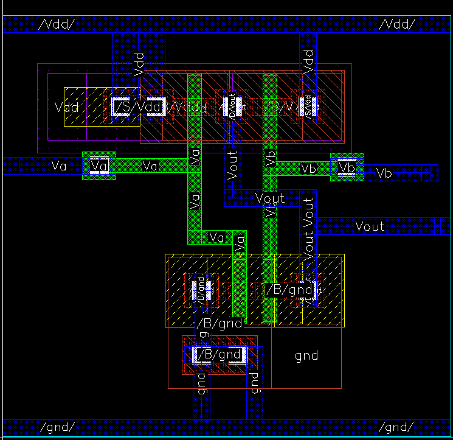
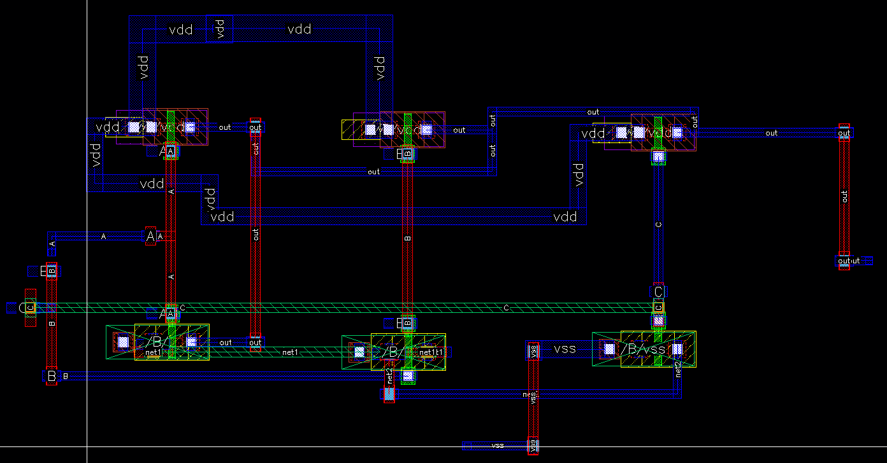

 8-Bit Asynchronous Up Counter using Master-Slave JK Flip-Flops

**Author:** Mubeena Mirshad  
**Project Guide:** Dr. P Ranga Babu  
**Design and Simulation Environment:** Cadence Virtuoso  
**Project Area:** Digital IC Design / Sequential Logic


Transistor-level schematic and physical layout of an 8-bit asynchronous (ripple) up counter, built from NAND-based master-slave JK flip-flops in Cadence Virtuoso using the `gpdk090` 90 nm process.

---

## Table of Contents

- [Overview](#overview)
- [Design Hierarchy and Architecture](#design-hierarchy-and-architecture)
- [Technology and Device Sizing](#technology-and-device-sizing)
- [Circuit Schematics and Physical Layouts](#circuit-schematics-and-physical-layouts)
  - [1. 2-Input CMOS NAND Gate](#1-2-input-cmos-nand-gate)
  - [2. 3-Input CMOS NAND Gate](#2-3-input-cmos-nand-gate)
  - [3. Master-Slave JK Flip-Flop](#3-master-slave-jk-flip-flop)
  - [4. 8-Bit Asynchronous Up Counter](#4-8-bit-asynchronous-up-counter)
- [Transient Simulation Results](#transient-simulation-results)
- [Performance Analysis](#performance-analysis)
  - [Key Specifications](#key-specifications)
  - [Timing Estimates](#timing-estimates)
  - [Power, PDP and EDP](#power-pdp-and-edp)
- [Repository Structure](#repository-structure)
- [How to Reproduce](#how-to-reproduce)
- [Conclusion](#conclusion)

---

## Overview

An 8-bit asynchronous up counter steps through the binary states `00000000` (0) to `11111111` (255) and then rolls over, so it is a MOD-256 counter.

A level-triggered JK flip-flop with J = K = 1 toggles repeatedly while the clock stays high (the race-around condition). To avoid this, each stage here is a master-slave JK flip-flop made entirely of static CMOS NAND gates.

Every flip-flop is wired in toggle mode (J = K = V<sub>DD</sub>). The master is transparent while the clock is high and the slave while it is low, so a stage changes its output on the **falling edge** of its clock input. The clock drives only the first stage (Q0). Each later stage is clocked by the **Q output** of the previous stage, so a falling edge on Q(n-1) toggles Q(n). This is what makes the counter count up. Driving each stage from Q̄ instead would make it count down.

Because the clock ripples through the chain instead of reaching all stages at once, the outputs do not change at the same instant. The resulting delay is analysed in [Performance Analysis](#performance-analysis).

---

## Design Hierarchy and Architecture

The design follows a bottom-up full-custom methodology.

1. **Leaf cells**
   - 2-input CMOS NAND gate (`pmos1v`, `nmos1v`), 4 transistors
   - 3-input CMOS NAND gate (`pmos1v`, `nmos1v`), 6 transistors

2. **Master-slave JK flip-flop** (9 gates, 40 transistors)
   - 2 × 3-input NAND: input steering, J·CLK·Q̄ and K·CLK·Q, with Q and Q̄ fed back from the slave
   - 2 × 2-input NAND: master SR latch
   - 2 × 2-input NAND: slave gating, driven by the inverted clock
   - 2 × 2-input NAND: slave SR latch, which produces Q and Q̄
   - 1 × 2-input NAND with its inputs tied together: clock inverter for the slave

3. **Top level**
   - Eight cascaded flip-flops `FF0` to `FF7` give outputs `Q0` (LSB) to `Q7` (MSB), 320 transistors in total.

---

## Technology and Device Sizing

| Parameter | Specification |
|:---|:---|
| EDA suite | Cadence Virtuoso (Schematic Editor, ADE L with Spectre, Layout Suite XL) |
| Process design kit | `gpdk090` (90 nm generic PDK) |
| Device models | `gpdk090_pmos1v` / `gpdk090_nmos1v` |
| Channel length (L) | 100 nm |
| Channel width (W) | 120 nm, multiplier m = 1 (minimum-size devices, no PMOS upsizing) |
| Supply voltage (V<sub>DD</sub>) | 1.0 V |
| Counting range | 0 to 255 (`0x00` to `0xFF`, 256 states) |

---

## Circuit Schematics and Physical Layouts

### 1. 2-Input CMOS NAND Gate

Static CMOS gate with two parallel PMOS pull-up transistors (`PM0`, `PM1`) and two series NMOS pull-down transistors (`NM0`, `NM1`).

| Schematic View | Physical Layout View |
|:---:|:---:|
|  |  |

---

### 2. 3-Input CMOS NAND Gate

Static CMOS gate with three parallel PMOS pull-up transistors (`PM0` to `PM2`) and three series NMOS pull-down transistors (`NM0` to `NM2`).

| Schematic View | Physical Layout View |
|:---:|:---:|
|  |  |

---

### 3. Master-Slave JK Flip-Flop

Gate-level schematic and full-custom layout of the master and slave stages. Q and Q̄ from the slave are fed back to the input-steering NAND gates, which prevents the race-around condition at J = K = 1.

**Gate-Level Schematic**


**Physical Layout**


---

### 4. 8-Bit Asynchronous Up Counter

Eight master-slave JK flip-flops arranged as a 2 × 4 array, with the inter-stage ripple clock routed from each Q output to the next clock input.

**Schematic**

.jpg)

**Physical Layout**


---

## Transient Simulation Results

The transient analysis was run in Cadence Spectre with a 1.0 V square-wave clock (`/clk`) of 16 ns period (62.5 MHz) and a stop time of 4.2 µs. Each output toggles at half the rate of the one before it:

| Output | Frequency |
|:---|:---|
| `/Q0` (LSB) | f<sub>clk</sub> / 2 |
| `/Q1` | f<sub>clk</sub> / 4 |
| `/Q2` | f<sub>clk</sub> / 8 |
| `/Q3` | f<sub>clk</sub> / 16 |
| `/Q4` | f<sub>clk</sub> / 32 |
| `/Q5` | f<sub>clk</sub> / 64 |
| `/Q6` | f<sub>clk</sub> / 128 |
| `/Q7` (MSB) | f<sub>clk</sub> / 256 |

With a 16 ns period, `/Q7` first rises after 128 clock periods (about 2.05 µs) and the counter rolls over after 256 periods (about 4.10 µs), so the 4.2 µs stop time captures one full 0 to 255 sweep. Each output lags the one before it by one flip-flop delay, as discussed in [Timing Estimates](#timing-estimates).

### Window 1 (1.0 µs to 2.05 µs): Lower-to-Mid Bit Transitions


### Window 2 (2.1 µs to 3.15 µs): MSB (`/Q7`) Low-to-High Transition


### Window 3 (3.1 µs to 4.15 µs): Full Rollover (`11111111` to `00000000`)


---

## Repository Structure

```text
8-bit-asynchronous-up-counter/
│
├── README.md
│
└── Images/
    ├── 01_2input_nand_schematic.png
    ├── 01_8_bit_counter_schematic (1).jpg
    ├── 02_2input_nand_layout.png
    ├── 03_3input_nand_schematic.png
    ├── 04_3input_nand_layout.png
    ├── 05_master_slave_jk_schematic.jpg
    ├── 06_master_slave_jk_layout.png
    ├── 07_8bit_asynchronous_counter_layout.png
    ├── 08_simulation_waveform_1.jpg
    ├── 09_simulation_waveform_2.jpg
    └── 10_simulation_waveform_3.jpg
```

## Performance Calculations

**Technology:** GPDK 90 nm  
**Supply Voltage:** 1 V  
**Clock Frequency:** 100 MHz

The values in this section are analytical estimates. The supply voltage, clock frequency, device sizes, and circuit structure are based on the Cadence design. The resistance, capacitance, and leakage values are estimated and were not extracted from Cadence. Therefore, the results below are not Spectre-measured values.

### 1. Propagation Delay

Propagation delay is the time taken by the output to respond after an input transition. For an RC node, the 50% propagation delay is approximated by:

$$
t = 0.69 \times \tau
$$

where $\tau$ is the Elmore time constant.

**2-Input NAND Gate**

**High-to-Low (Series NMOS Pull-Down):**

$$
\tau_f = R_n C_x + 2R_n C_L
$$

$$
= (10\,k\Omega)(2\,fF) + (20\,k\Omega)(10\,fF)
$$

$$
= 0.22\,ns
$$

$$
t_{PHL} = 0.69 \times 0.22 \approx 0.15\,ns
$$

**Low-to-High (Worst Case, Only One PMOS Conducting):**

$$
\tau_r = R_p C_L
$$

$$
= (25\,k\Omega)(10\,fF) = 0.25\,ns
$$

$$
t_{PLH} = 0.69 \times 0.25 \approx 0.17\,ns
$$

**Average Propagation Delay:**

$$
t_p = \frac{t_{PHL}+t_{PLH}}{2}
$$

$$
= \frac{0.15+0.17}{2} = 0.16\,ns
$$

**3-Input NAND Gate**

**High-to-Low Transition:**

$$
\tau_f = R_n C_x + 2R_n C_x + 3R_n C_L
$$

$$
= 0.02 + 0.04 + 0.30 = 0.36\,ns
$$

$$
t_{PHL} = 0.69 \times 0.36 \approx 0.25\,ns
$$

**Low-to-High Transition:**

$$
\tau_r = 0.25\,ns
$$

$$
t_{PLH} = 0.69 \times 0.25 \approx 0.17\,ns
$$

**Average Propagation Delay:**

$$
t_p = \frac{0.25+0.17}{2} = 0.21\,ns
$$

**Master-Slave JK Flip-Flop (Clock-to-Q Delay)**

The clock-to-Q path is assumed to pass through three NAND2 stages. A rising output passes through two rising gate transitions and one falling transition, while a falling output passes through one rising and two falling transitions.

$$
t_{PLH(FF)} = 2(0.17)+0.15 = 0.49\,ns
$$

$$
t_{PHL(FF)} = 0.17+2(0.15) = 0.47\,ns
$$

$$
t_{p(FF)} = \frac{0.49+0.47}{2} = 0.48\,ns
$$

### 2. Elmore Delay

For a node driven through resistors, the Elmore time constant is calculated as the sum of each capacitance multiplied by the resistance shared with the output path:

$$
\tau = \sum_i C_i R_{i,\text{shared}}
$$

The values for one NAND2 gate are:

| Transition | Calculation | Elmore Time Constant ($\tau$) |
|---|---|---:|
| Pull-down (Series NMOS) | $10\,k\Omega \times 2\,fF + 20\,k\Omega \times 10\,fF$ | 0.22 ns |
| Pull-up (Single PMOS) | $25\,k\Omega \times 10\,fF$ | 0.25 ns |
| Average | $(0.22+0.25)/2$ | 0.235 ns |

Assuming three NAND2 stages per flip-flop and eight cascaded flip-flops, the time constants add along the ripple path:

$$
\tau_{FF} = 3 \times 0.235 = 0.705\,ns
$$

$$
\tau_{ripple} = 8 \times 0.705 = 5.64\,ns
$$

The corresponding 50% ripple delay is:

$$
t_{ripple} = 0.69 \times 5.64 \approx 3.89\,ns
$$

### 3. Ripple Delay

The ripple delay is estimated analytically from the NAND gate delays and is not measured in Spectre.

The approximate eight-stage ripple delay is:

$$
t_{ripple} = 8 \times t_{p(FF)}
$$

$$
= 8 \times 0.48 = \boxed{3.84\,ns}
$$

The Elmore estimate in Section 2 (3.89 ns) agrees with this result to within approximately 1.5%.

The worst-case transition occurs during the rollover from `01111111` to `10000000`, where Q0 to Q6 fall sequentially and Q7 rises last:

$$
t_{rollover} = 7 \times 0.47 + 0.49
$$

$$
= \boxed{3.78\,ns}
$$

The clock period is 10 ns, which is longer than the estimated ripple delay. Therefore, the outputs are expected to settle before the next clock cycle under these assumptions.

The estimated ripple delay corresponds to a theoretical frequency of:

$$
f_{max} \approx \frac{1}{3.84\,ns} \approx 260\,MHz
$$

This is an approximate timing limit, not a verified maximum operating frequency. Applications that decode the counter outputs must also account for temporary intermediate states during ripple propagation.

### 4. Dynamic Power

Dynamic power is the power consumed due to switching activity in the circuit.

$$
P_{dynamic} = C V_{DD}^{2} f
$$

This estimate considers only the eight Q output nodes. Each output Q(n) toggles at a frequency of:

$$
f_n = \frac{f}{2^{(n+1)}}
$$

Assuming a load capacitance of 10 fF for each of the eight Q outputs:

$$
P_{dynamic} = C V_{DD}^{2} f
\left(\frac{1}{2}+\frac{1}{4}+\cdots+\frac{1}{256}\right)
$$

$$
= (10\times10^{-15})(1)^2(100\times10^6)
(1-2^{-8})
$$

$$
= 0.9961\,\mu W
$$

$$
\boxed{P_{dynamic} \approx 1.00\,\mu W}
$$

Switching activity at the internal flip-flop nodes is not included in this estimate. Therefore, the actual total power may differ from the calculated output-node power.

### 5. Static Power

Static power is the power consumed due to leakage current when the circuit is not switching.

$$
P_{static} = V_{DD} \times I_{leakage}
$$

$$
= 1\,V \times 10\,nA
$$

$$
\boxed{P_{static} = 0.01\,\mu W}
$$

### 6. Average Power

The average power is the sum of dynamic and static power:

$$
P_{avg} = P_{dynamic} + P_{static}
$$

$$
= 0.9961 + 0.01
$$

$$
= 1.0061\,\mu W
$$

$$
\boxed{P_{avg} \approx 1.01\,\mu W}
$$

Dynamic power contributes approximately 99% of the estimated total power.

### 7. Power-Delay and Energy-Delay Product

**1. Power-Delay Product (PDP):**

PDP represents the product of average power and ripple propagation delay.

$$
PDP = P_{avg} \times t_{ripple}
$$

$$
= (1.01\times10^{-6})(3.84\times10^{-9})
$$

$$
\boxed{PDP = 3.88\times10^{-15}\,J = 3.88\,fJ}
$$

**2. Energy-Delay Product (EDP):**

EDP is the product of PDP and ripple propagation delay.

$$
EDP = PDP \times t_{ripple}
$$

$$
= (3.88\times10^{-15})(3.84\times10^{-9})
$$

$$
\boxed{EDP = 1.49\times10^{-23}\,J\cdot s}
$$

### 8. Performance Summary

| Parameter | Estimated Value |
|---|---:|
| Technology | GPDK 90 nm |
| Supply Voltage | 1 V |
| Clock Frequency | 100 MHz |
| $t_{PHL}$ (NAND2) | 0.15 ns |
| $t_{PLH}$ (NAND2) | 0.17 ns |
| Average Propagation Delay (NAND2) | 0.16 ns |
| Average Propagation Delay (NAND3) | 0.21 ns |
| Flip-Flop Clock-to-Q Delay | 0.48 ns |
| Elmore Time Constant (One NAND2) | 0.235 ns |
| Elmore Time Constant (Eight-Stage Ripple) | 5.64 ns |
| Eight-Stage Ripple Delay | 3.84 ns |
| Dynamic Power | 1.00 µW |
| Static Power | 0.01 µW |
| Average Power | 1.01 µW |
| PDP | 3.88 fJ |
| EDP | $1.49\times10^{-23}\,J\cdot s$ |

---

## How to Reproduce

1. Launch Cadence Virtuoso in a working directory configured with the `gpdk090` library.
2. Create a new library and build the leaf cells `NAND2` and `NAND3` with `pmos1v` and `nmos1v` (W = 120 nm, L = 100 nm). Create their symbols and DRC/LVS-clean layouts.
3. Build the master-slave JK flip-flop schematic and layout from these gates. Check toggle operation with J = K = V<sub>DD</sub> = 1.0 V.
4. Cascade eight flip-flop instances to form the counter. Connect the external clock to `FF0` only, and connect the `Q` output of each stage to the clock input of the next stage.
5. Place a 1.0 V DC source for V<sub>DD</sub> and a `vpulse` clock source (0 V to 1.0 V, 16 ns period, 5 ps rise time).
6. The flip-flops have no reset, so set initial conditions (`ic`) so that `Q0` to `Q7` start at 0 V. Without them the starting state of the latches is undefined.
7. Open ADE L, select the Spectre simulator, set the transient stop time to 4.2 µs, and plot `/clk` together with `/Q0` to `/Q7`.
8. To replace the estimates in [Performance Analysis](#performance-analysis) with measured values, use the ADE calculator `delay()` function from the clock edge to each Q output, and average the supply current over the full run (P = V<sub>DD</sub> × average of the supply current).

---

## Conclusion

The 8-bit asynchronous up counter was designed at transistor level, laid out in full custom, and simulated in `gpdk090`. The transient results show the expected frequency division from `/Q0` (f/2) to `/Q7` (f/256) and the MOD-256 rollover.

The main limitation of the design is the ripple delay. The MSB settles about eight flip-flop delays after the clock edge (about 3.24 ns by estimate), so the outputs pass through transient codes during each carry. The next steps are to extract measured delay and power from Spectre, and to compare against a synchronous counter built from the same flip-flops.

---

## Author

**Mubeena Mirshad**  
M.Tech, VLSI and Microelectronics | Digital IC Design | Full-Custom VLSI Design
