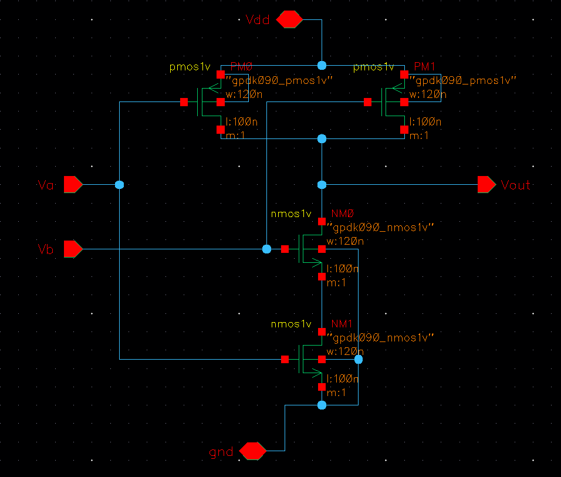
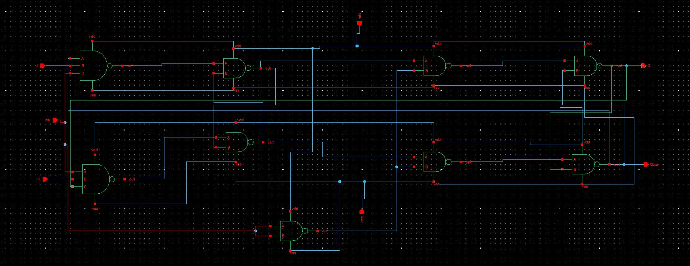
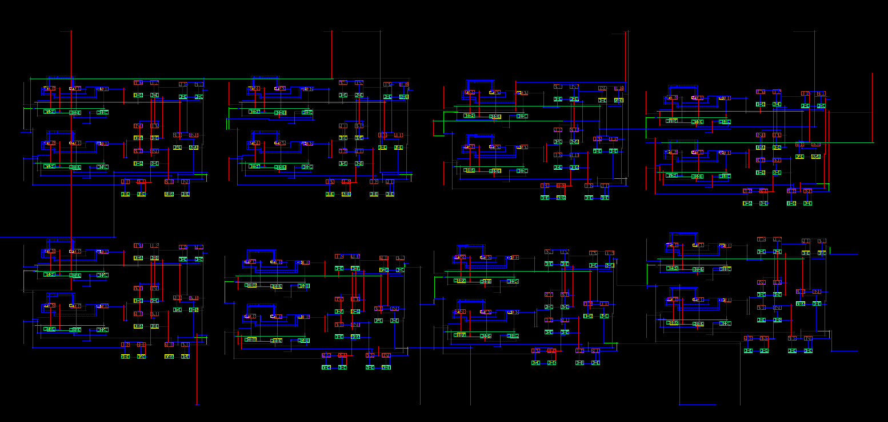
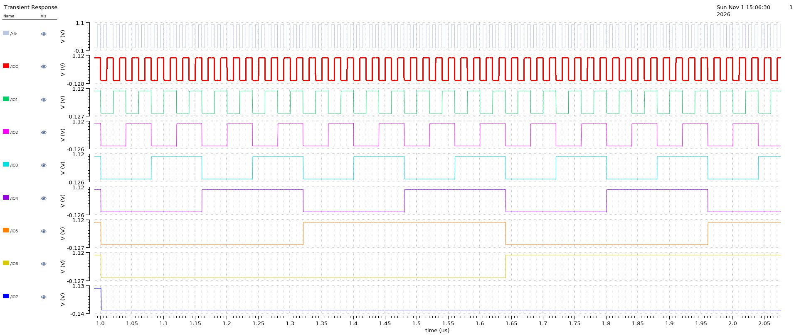

# 8-Bit Asynchronous Up Counter using Master-Slave JK Flip-Flops

**Author:** Mubeena Mirshad  
**Design and Simulation Environment:** Cadence Virtuoso  
**Project Area:** Digital IC Design / Sequential Logic    
**Project Guide:** Dr. P Ranga Babu


A full-custom CMOS transistor-level and physical layout implementation of an **8-Bit Asynchronous (Ripple) Up Counter** designed using NAND-based **Master-Slave JK Flip-Flops** in **Cadence Virtuoso** (`gpdk090` 90nm process technology).

---

## Table of Contents

- [Overview](#overview)
- [Design Hierarchy & Architecture](#design-hierarchy--architecture)
- [Transistor Sizing & Technology Specifications](#transistor-sizing--technology-specifications)
- [Circuit Schematics & Physical Layouts](#circuit-schematics--physical-layouts)
  - [1. 2-Input CMOS NAND Gate](#1-2-input-cmos-nand-gate)
  - [2. 3-Input CMOS NAND Gate](#2-3-input-cmos-nand-gate)
  - [3. Master-Slave JK Flip-Flop](#3-master-slave-jk-flip-flop)
  - [4. Top-Level 8-Bit Asynchronous Up Counter](#4-top-level-8-bit-asynchronous-up-counter)
- [Transient Simulation Results](#transient-simulation-results)
- [Repository Structure](#repository-structure)
- [How to Reproduce](#how-to-reproduce)

---

## Overview

An **8-bit asynchronous up counter** counts binary states from `00000000` ($0_{10}$) to `11111111` ($255_{10}$), representing a **MOD-256** counter.

To eliminate the **race-around condition** associated with level-triggered JK flip-flops when $J = K = 1$, this design employs a Master-Slave JK Flip-Flop architecture built entirely from static CMOS NAND gates.

Each flip-flop is configured in toggle mode ($J = K = V_{DD}$). The output transition of each stage drives the clock input of the subsequent stage, enabling asynchronous binary up-counting.

---
# Performance Analysis and Calculations

## 8-Bit Asynchronous Up Counter Using Master-Slave JK Flip-Flops

### 📊 Key Specifications

| Parameter | Value / Characteristic | Notes |
|:---|:---|:---|
| Technology Node | 90 nm CMOS (GPDK90) | Cadence technology |
| Supply Voltage ($V_{DD}$) | 1.0 V | Based on schematic |
| Counter Architecture | 8-bit Asynchronous | Ripple counter |
| Flip-Flop Type | Master-Slave JK | NAND-based implementation |
| Number of Flip-Flops | 8 | One per counter bit |
| Counting Sequence | 00000000 to 11111111 | Modulo-256 counting |
| Clock Frequency ($f$) | 50 MHz (Assumed) | 20 ns clock period |
| Average Stage Delay ($t_p$) | 0.20 ns  | Mean of rise and fall delays |
| Critical Ripple Delay | 1.60 ns  | Approximate eight-stage delay |
| High-to-Low Delay ($t_{PHL}$) | 0.18 ns  | Output falling transition |
| Low-to-High Delay ($t_{PLH}$) | 0.22 ns  | Output rising transition |
| Dynamic Power ($P_{dynamic}$) | 1.00 µW  | Switching power |
| Static Power ($P_{static}$) | 0.01 µW  | Leakage power |
| Total Average Power ($P_{avg}$) | 1.01 µW  | Dynamic + static power |
| Power-Delay Product (PDP) | 1.616 fJ  | Average power × ripple delay |
| Energy-Delay Product (EDP) | 2.586 × 10⁻²⁴ J·s  | Power × delay squared |

---
## Design Hierarchy & Architecture

The design follows a bottom-up full-custom VLSI methodology:

1. **Standard Cell Primitives:**
   - **2-Input CMOS NAND Gate** (`pmos1v`, `nmos1v`)
   - **3-Input CMOS NAND Gate** (`pmos1v`, `nmos1v`)

2. **Sequential Building Block:**
   - **Master-Slave JK Flip-Flop:** Constructed using two 3-input NAND gates (input steering), six 2-input NAND gates (Master SR latch, Slave SR latch, and feedback steering), and one 2-input NAND gate wired as an inverter for the complementary slave clock.

3. **Top-Level System:**
   - **8-Bit Ripple Counter:** Eight cascaded Master-Slave JK Flip-Flop instances (`FF0` through `FF7`), producing outputs `Q0` (LSB) through `Q7` (MSB).

---

## Transistor Sizing & Technology Specifications

| Parameter | Specification |
|:---|:---|
| **EDA Suite** | Cadence Virtuoso (Schematic Editor, ADE L / Spectre, Layout Suite XL) |
| **Process Design Kit** | `gpdk090` (90nm Generic PDK) |
| **Device Models** | `gpdk090_pmos1v` / `gpdk090_nmos1v` |
| **Channel Length ($L$)** | $100\text{ nm}$ |
| **Channel Width ($W$)** | $120\text{ nm}$ (Multiplier $m = 1$) |
| **Supply Voltage ($V_{DD}$)** | $1.1\text{ V}$ |
| **Counting Range** | $0$ to $255$ (`0x00` to `0xFF`, 256 states) |

---

## Circuit Schematics & Physical Layouts

### 1. 2-Input CMOS NAND Gate

Static CMOS implementation using parallel PMOS pull-up transistors (`PM0`, `PM1`) and series NMOS pull-down transistors (`NM0`, `NM1`).

| Schematic View | Physical Layout View |
|:---:|:---:|
|  |  |

---

### 2. 3-Input CMOS NAND Gate

Static CMOS implementation using three parallel PMOS pull-up transistors (`PM0`–`PM2`) and three series NMOS pull-down transistors (`NM0`–`NM2`).

| Schematic View | Physical Layout View |
|:---:|:---:|
|  |  |

---

### 3. Master-Slave JK Flip-Flop

Gate-level schematic and full-custom physical layout integrating the Master and Slave stages with feedback paths (`Q` and `Qbar`) to achieve edge-triggered toggling without race-around instability.

**Gate-Level Schematic**



**Physical Layout**


---

### 4. 8-Bit Asynchronous Up Counter

Full-chip implementation of the 8-bit asynchronous up counter, consisting of eight cascaded Master-Slave JK Flip-Flop blocks arranged in a compact $2 \times 4$ array with inter-stage ripple clock routing.

**Schematic**

.jpg)

**Physical Layout**



---

## Transient Simulation Results

Transient simulations were performed in **Cadence Spectre** with a $1.1\text{ V}$ square-wave input clock (`/clk`).

The waveforms demonstrate frequency division by $2^n$ at each successive output stage (`/Q0` through `/Q7`), verifying the 8-bit binary counting operation from `00000000` to `11111111`.

- **`/Q0` (LSB):** $f_{clk}/2$
- **`/Q1`:** $f_{clk}/4$
- **`/Q2`:** $f_{clk}/8$
- **`/Q3`:** $f_{clk}/16$
- **`/Q4`:** $f_{clk}/32$
- **`/Q5`:** $f_{clk}/64$
- **`/Q6`:** $f_{clk}/128$
- **`/Q7` (MSB):** $f_{clk}/256$

### Window 1 ($1.0\text{ }\mu s - 2.05\text{ }\mu s$): Lower-to-Mid Bit Transitions



### Window 2 ($2.1\text{ }\mu s - 3.15\text{ }\mu s$): MSB (`/Q7`) Low-to-High Transition


### Window 3 ($3.1\text{ }\mu s - 4.15\text{ }\mu s$): Full Rollover (`11111111` → `00000000`)


Timing Performance Breakdown (`tPLH`, `tPHL`, `tpd`, `tcd`) & RC Parameters

All timing parameters are referenced to the 50% supply threshold (`Vmid = 0.5 V` at `VDD = 1.0 V`). The following values are illustrative theoretical estimates, not extracted Cadence measurements.

| **Hierarchy Block** | **`tPLH`** | **`tPHL`** | **`tpd` (Average Delay)** | **`tcd` (Contamination Delay)** | **Effective Resistance (`Reff`)** | **Effective Capacitance (`Cload`)** | **Elmore Time Constant (`τ = RC`)** | **Critical Path Description** |
| ------------------- | ---------- | ---------- | ------------------------- | ------------------------------- | --------------------------------- | ----------------------------------- | --------------------------------- | ------------------------------ |
| **2-Input NAND Gate** | 0.22 ns | 0.18 ns | 0.20 ns | 0.18 ns | 20 kΩ | 10 fF | 0.20 ns | NAND pull-up / pull-down transition |
| **3-Input NAND Gate** | 0.24 ns | 0.20 ns | 0.22 ns | 0.20 ns | 22 kΩ | 10 fF | 0.22 ns | Three-transistor series pull-down path |
| **Master-Slave JK Flip-Flop** | 0.22 ns | 0.18 ns | 0.20 ns | 0.18 ns | 20 kΩ | 10 fF | 0.20 ns | Master-to-slave data transfer |
| **Single Counter Stage** | 0.22 ns | 0.18 ns | 0.20 ns | 0.18 ns | 20 kΩ | 10 fF | 0.20 ns | Clock-to-output transition |
| **8-Bit Asynchronous Counter** | 1.76 ns | 1.44 ns | 1.60 ns | 0.18 ns* | — | — | — | Eight-stage ripple propagation during counter rollover |


---

## Repository Structure

```text
8-bit-asynchronous-up-counter/
│
├── README.md
│
├── Images/
│   ├── 01_2input_nand_schematic.png
│   ├── 01_8_bit_counter_schematic (1).jpg
│   ├── 02_2input_nand_layout.png
│   ├── 03_3input_nand_schematic.png
│   ├── 04_3input_nand_layout.png
│   ├── 05_master_slave_jk_schematic.jpg
│   ├── 06_master_slave_jk_layout.png
│   ├── 07_8bit_asynchronous_counter_layout.png
│   ├── 08_simulation_waveform_1.jpg
│   ├── 09_simulation_waveform_2.jpg
│   └── 10_simulation_waveform_3.jpg
│
└── docs/
```

---

## How to Reproduce

1. Launch **Cadence Virtuoso** in a working directory configured with the `gpdk090` library.
2. Create a new library and build the leaf cells (`NAND2` and `NAND3`) using `pmos1v` and `nmos1v` ($W = 120\text{ nm}$, $L = 100\text{ nm}$), then generate their corresponding symbols and DRC/LVS-clean layouts.
3. Instantiate the NAND gates to construct the **Master-Slave JK Flip-Flop** schematic and layout, verifying functionality with $J = K = 1.1\text{ V}$.
4. Cascade eight instances of the Master-Slave JK Flip-Flop symbol to form the **8-Bit Asynchronous Up Counter**.
5. Open **ADE L**, select the **Spectre** simulator, set the transient stop time to $4.2\text{ }\mu s$, and plot `/clk` along with `/Q0`–`/Q7`.


## Conclusion

This project demonstrates the complete design and implementation of an **8-bit asynchronous up counter** using NAND-based Master-Slave JK Flip-Flops in Cadence Virtuoso. The design covers transistor-level schematic development, CMOS physical layout implementation, and transient simulation using the GPDK 90nm technology. The simulation results verify the expected MOD-256 counting sequence and frequency division across all eight stages.

The project provided practical experience in **CMOS circuit design, sequential logic, full-custom VLSI design, and circuit simulation**, strengthening the understanding of digital IC design concepts and their implementation.

---

## Author

**Mubeena Mirshad**

Digital IC Design | Full-Custom VLSI Design
