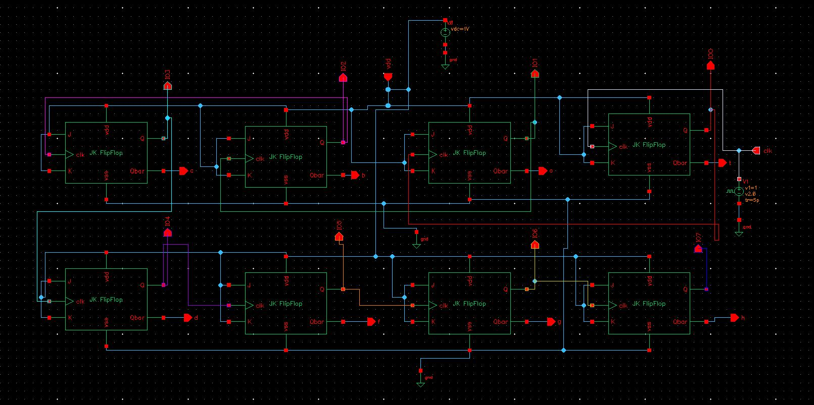
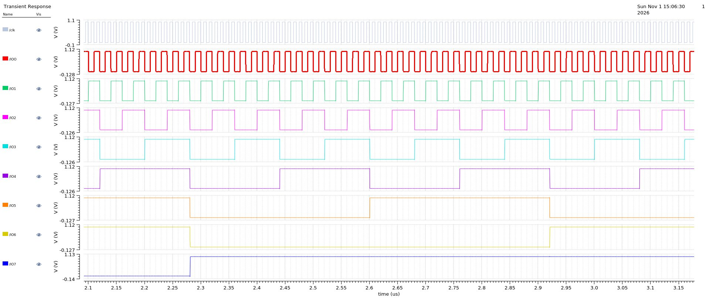
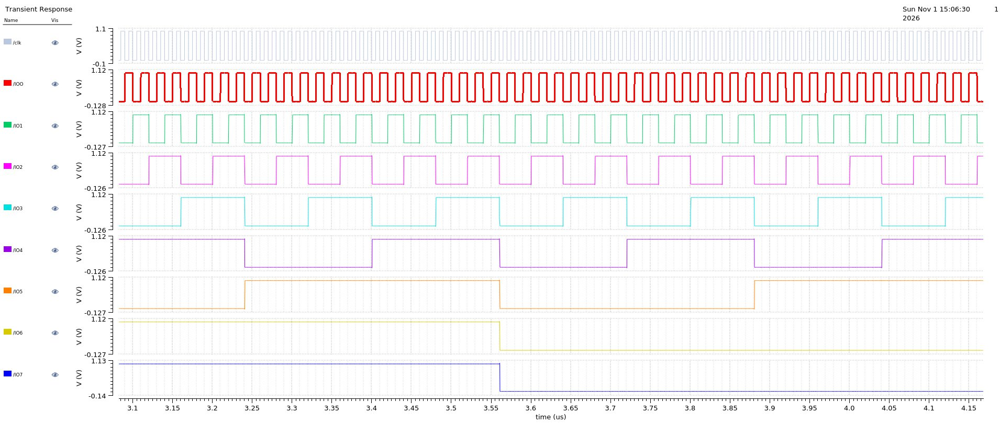

# 8-Bit Asynchronous Up Counter Using Master–Slave JK Flip-Flops

**Author:** Mubeena Mirshad  
**Design and simulation environment:** Cadence Virtuoso  
**Project area:** Digital IC Design / Sequential Logic

## Abstract

This project presents the design and transient-simulation study of an 8-bit asynchronous up counter using master–slave JK flip-flops. The master–slave JK flip-flop is implemented using 2-input and 3-input NAND gates. The circuit schematic and transient waveforms are documented using screenshots captured from Cadence Virtuoso.

An asynchronous counter, also known as a ripple counter, uses the output transition of one flip-flop stage to trigger the next stage. The resulting propagation of transitions through the stages produces an 8-bit binary counting sequence.

## Project objectives

- Design an 8-bit asynchronous up-counter architecture.
- Study the operation of a master–slave JK flip-flop.
- Implement the master–slave JK logic using 2-input and 3-input NAND gates.
- Observe the counter outputs through transient simulation.
- Examine the ripple behaviour of a multi-stage counter.

## Design overview

### 1. Complete 8-bit counter schematic

The following schematic shows the counter architecture using eight JK flip-flop stages.



### 2. NAND-based master–slave JK flip-flop

The master–slave JK flip-flop is constructed using NAND-gate logic. The implementation uses 2-input and 3-input NAND gates.


## Working principle

1. A JK flip-flop toggles when both its J and K inputs are at logic HIGH.
2. The first flip-flop receives the external clock signal.
3. The output transition of each stage is used to trigger the following stage, creating a ripple-counter arrangement.
4. Each successive stage divides the frequency by two.
5. The combined outputs represent an 8-bit binary count.

For an 8-bit up counter, the expected ideal sequence is:

```text
00000000
00000001
00000010
       ...
11111110
11111111
00000000  (repeats)
```

**Clock-edge note:** The exact inter-stage connection (Q or Q-bar) and the active triggering edge depend on the implemented flip-flop's clock polarity and the required counting direction. Refer to the actual schematic when interpreting the bit sequence.

## Simulation outputs

Transient simulation was performed in Cadence Virtuoso. The following three screenshots are the **simulation output results**. Each plot displays the clock signal and the counter output signals (`I00` to `I07`) over a different time interval.

### Simulation output 1


### Simulation output 2



### Simulation output 3



These results are included as the functional verification evidence for the counter. The output signals show the frequency-division behaviour expected from successive counter stages. The exact bit order and count direction should be confirmed against the circuit connections and the intended clock edge.

## Design and simulation details

| Parameter | Details |
|---|---|
| Circuit | 8-bit asynchronous up counter |
| Flip-flop | Master–slave JK |
| Logic implementation | 2-input and 3-input NAND gates |
| Design and simulation tool | Cadence Virtuoso |
| Analysis | Transient analysis |
| Verification evidence | Schematic and waveform screenshots |
| Native Cadence project files | Not included |

The supply voltage, clock period, transient stop time, device models, and other simulator settings have not been specified in this repository. They should be added only after checking the original simulation setup.

## Repository contents

```text
8-bit-asynchronous-up-counter/
├── README.md
├── .gitignore
├── images/
│   ├── 01_8_bit_counter_schematic.jpg
│   ├── 02_master_slave_jk_nand_implementation.jpg
│   ├── 03_simulation_output_1.jpg
│   ├── 04_simulation_output_2.jpg
│   └── 05_simulation_output_3.jpg
├── docs/
│   └── design_notes.md
└── simulation/
    └── README.md
```

## Limitations and future improvements

- Include the native Cadence Virtuoso schematic and simulation files when they become available.
- Document the exact clock period, supply voltage, and transient-analysis settings.
- Add a verified output-state table for the eight counter bits.
- Measure and discuss propagation delay through the ripple stages.
- Compare the asynchronous architecture with a synchronous counter.

## Author

**Mubeena Mirshad**

Digital IC Design Project  
Cadence Virtuoso

---

*This repository currently contains design documentation and screenshot-based simulation evidence. It does not contain the editable Cadence Virtuoso source files.*
